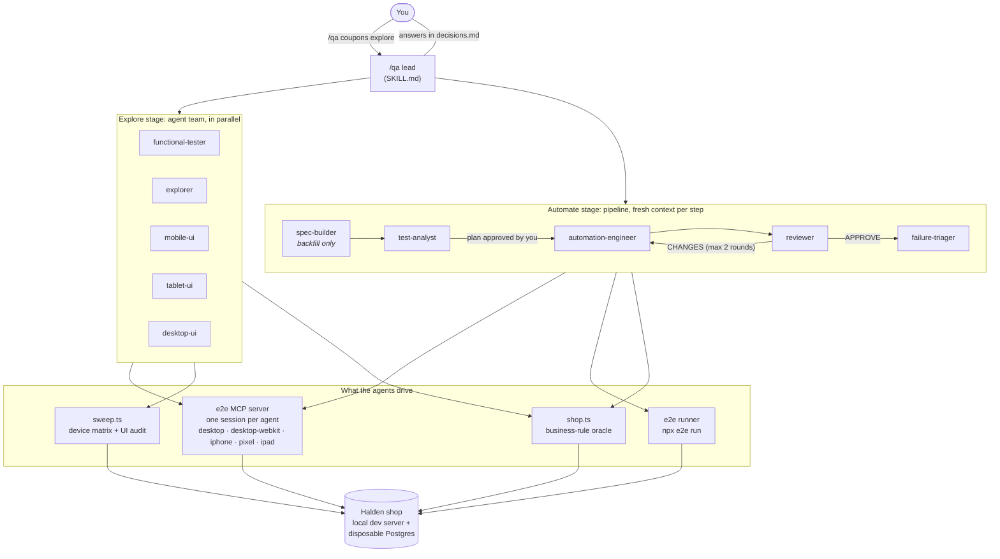
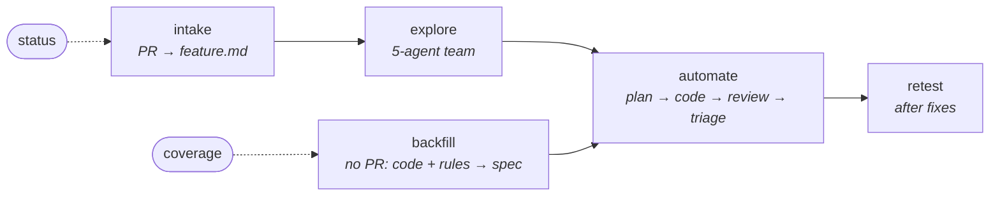

# Agentic QA for Halden Outfitters

**A team of ten Claude Code agents that specifies, explores, plans, writes, reviews and triages end-to-end tests, with a human approving every decision that matters.**

This guide explains what the system is, why it is built the way it is, what each agent does, and how to run it. It is the companion to [`CLAUDE.md`](../CLAUDE.md) (the rules every test follows) and [`.claude/skills/qa/SKILL.md`](../.claude/skills/qa/SKILL.md) (the lead's playbook).

---

## Contents
1. [The problem it solves](#1-the-problem-it-solves)
2. [Two layers of agents](#2-two-layers-of-agents)
3. [Architecture](#3-architecture)
4. [The ten agents](#4-the-ten-agents)
5. [The stages of `/qa`](#5-the-stages-of-qa)
6. [The feature folder](#6-the-feature-folder-one-source-of-truth-per-feature)
7. [Guardrails: how the system keeps agents honest](#7-guardrails-how-the-system-keeps-agents-honest)
8. [Planted bugs: measuring the team](#8-planted-bugs-measuring-the-team)
9. [Setup](#9-setup)
10. [Walkthroughs](#10-walkthroughs)
11. [Scripts reference](#11-scripts-reference)
12. [Where it came from: porting a production system](#12-where-it-came-from-porting-a-production-system)
13. [Limits and honest trade-offs](#13-limits-and-honest-trade-offs)

---

## 1. The problem it solves

Asking one AI agent to "write tests for checkout" produces tests that pass. That is the problem: an agent that reads the app and writes assertions will happily encode whatever the app does today, bugs included, and call it coverage.

This system is designed around the opposite instinct. It treats test automation as a QA engineering process with separated concerns:

- **What should happen** is written down first, from sources ranked by trust (business rules, code, docs), never from what the app happens to do.
- **What deserves a test** is decided by risk, by an agent that never writes code.
- **The test code** is written by a different agent that is forbidden from changing expected values.
- **Whether the test is any good** is judged by a third agent that never saw the author's reasoning and must prove each test can fail.
- **Why a test fails** is classified by a fourth agent that may fix locators and timing, but must escalate anything that touches behaviour.
- **Every judgement call** (a conflicting spec, a suspected bug, the test plan itself) lands in one file the human answers.

---

## 2. Two layers of agents

Halden already used AI *inside* its tests. This system adds a second layer *around* them. Keeping the two apart is a deliberate design choice.

| | Runtime agents | Claude Code agents |
|---|---|---|
| Where | `agents/personas.ts`, run by the `e2e` runner | `.claude/agents/*.md`, run by Claude Code |
| Model | OpenRouter (Haiku for tests, Sonnet for exploring) | Claude Opus / Sonnet |
| Job | Drive the shop: `agent.act('add the stove to the cart')`, `e2e explore` personas in the bug bash | Do QA engineering: specs, plans, code, review, triage, exploratory testing |
| Output | Clicks, judgements, findings in `report.json` | Specs, test plans, page objects, tests, reviews, reports |
| Cost control | The replay cache: a verified step replays with no model call; CI runs `--strict-cache` | Fresh context per pipeline step, batched runs, required stops |

The Claude agents *use* the runtime layer: the automation engineer writes `agent.act` steps where a path legitimately varies, the triager reads agent transcripts on failure, and the lead can launch the runtime bug-bash personas as a cheap pre-pass whose claims the Claude functional tester must verify.

---

## 3. Architecture



**One server, many browsers.** The `e2e` MCP server (`.mcp.json` → `e2e.qa.config.ts`) gives every agent its own isolated browser session on its own device target. Five testers can look at the shop at once, on a phone, a tablet and two desktop engines, without touching each other's state.

**A disposable world.** Every test reseeds the database. The QA team works on a freshly seeded shop that the lead resets before and after each run. Nothing an agent does can damage anything real; `utils/shop-db.ts` refuses any non-local database outright.

---

## 4. The ten agents

Each agent is one Markdown file in `.claude/agents/` with a role, a method, what it owns, what it explicitly does **not** own, and the exact shape of its output. Ownership boundaries are what let five agents work in parallel without duplicating or contradicting each other.

### The explore team (run in parallel by the lead)

| Agent | Purpose | Owns | Browser | Writes data? |
|---|---|---|---|---|
| **functional-tester** | Checks the feature does what the spec says, to the cent | Money, stock, coupons, payments, permissions, errors, screen-vs-database consistency, regressions. **The team's verifier**: every functional claim from anyone else (including the runtime bug-bash personas) is confirmed or rejected here before it counts | `desktop`, as Maya (+ admin) | Yes, on its own account |
| **explorer** | Finds what a case table misses, and what shoppers will expect | A market benchmark against real retailers (REI, Patagonia, Shopify checkout) written first, then 4–6 time-boxed charters with personas (the skeptic, the bargain hunter, the regretful buyer), then prioritised improvement suggestions | `desktop`, as Jonas | Yes, on its own account |
| **mobile-ui** | Catches the small phone defects that usually escape | iPhone (WebKit) and Android (Chromium) sizes: touch targets, the keyboard covering Pay, iOS input zoom, sticky headers, horizontal scroll | `iphone` + `pixel` | No (read-only) |
| **tablet-ui** | Hunts the gap between phone and desktop layouts | iPad and Android tablet, portrait and landscape, and **breakpoint boundaries** (767↔768, 1023↔1024 and the shop's own), where parts of a page switch layout at different widths | `ipad` | No |
| **desktop-ui** | Owns everything global | 1280 px to 2K and Safari desktop, plus copy, usability heuristics, visual consistency, keyboard-only and zoom accessibility. The other UI testers send it copy and usability issues | `desktop` + `desktop-webkit` | No |

### The automate pipeline (run in sequence, each with a fresh context)

| Agent | Purpose | Key rule |
|---|---|---|
| **spec-builder** | (Backfill only) writes `feature.md` for an existing feature that has no PR, from the shop's code, its SQL business rules, its docs and a read-only look at the running shop | Every row has a source and a confidence. Behaviour seen *only* in the running app is never a spec row: it goes to the user as a `BASELINE` question to accept or reject |
| **test-analyst** | Decides **what** deserves an E2E test, by risk, and writes `testplan.md` | Never writes code. Every expected result cites an oracle. Must trace every spec clause (enforced by `trace-check.ts`) and name the case that catches each planted bug |
| **automation-engineer** | Turns approved cases into page objects and tests | **Never changes an expected value.** If the shop disagrees with the plan, it keeps the plan's expectation and reports the mismatch. Checks every new locator live with the MCP `locate` tool |
| **reviewer** | Independently judges the new tests | Gets the diff, not the author's explanation. Proves each test can fail three ways: flip its expected value, skip its action, and switch on the planted bug it guards. A survivor is a Blocker |
| **failure-triager** | Finds out why a test fails | May fix locators, waits, setup and an agent goal's wording. **May not** touch an assertion, loosen a matcher, add a skip, or edit the replay cache. App bugs and intended changes are always escalated |

The **lead** is not an agent file: it is the `/qa` skill running in your main Claude Code session. It prepares each stage, writes the spawn prompts, merges reports, and stops at every gate for you.

---

## 5. The stages of `/qa`



| Command | What happens | Stops for you |
|---|---|---|
| `/qa <feature> intake` + pasted PR | The lead writes the full spec from the PR, the business rules, the code and the docs | Open questions |
| `/qa <feature> explore [bugs=random] [bugbash]` | Reset the shop (optionally with hidden planted bugs), brief, spawn the five testers, merge, triage, score | **Triage**: keep or drop every finding |
| `/qa <feature> automate [P0\|P1\|all]` | analyst → engineer → reviewer (≤2 rounds) → triager | **Plan approval**, with what is *not* being tested shown explicitly |
| `/qa <feature> backfill` | spec-builder, then the automate pipeline | **Spec review** (questions and baselines), then plan approval |
| `/qa <feature> retest` | Re-check open findings, regression sweep, update the ledger | — |
| `/qa <feature> status` | Stage, open decisions, findings, plan counts, coverage | — |
| `/qa coverage [<feature>\|next]` | Flow coverage across the shop, or the next flows to automate | — |

---

## 6. The feature folder: one source of truth per feature

```
tests/coupons/
  feature.md        the living spec: scope, roles, Given/When/Then rows, limits, business rules
  decisions.md      everything waiting on you (questions, triage, plan approval, suspected bugs)
  findings.json     every finding ever logged, with its lifecycle: open → fixed → verified
  testplan.md       every case, traced to its source, its flow, and the planted bug it guards
  coupons.guest.e2e.ts
.evidence/coupons/2026-11-25/   one explore run: reports, screenshots, sweeps, report.html
```

**One writer per file.** The lead owns the spec and the ledger, the analyst owns the plan, the engineer owns the code, testers write only inside their run folder. Parallel agents never overwrite each other. Full table: [`feature-folder.md`](../.claude/skills/qa/reference/feature-folder.md).

**An order of trust for "expected".** Every expected result carries a tag: `[pr]` > `[answer]` (your decision) > `[rule]` (the shop's SQL business rules and price rules) > `[code]` > `[doc]` > `[app]`. When sources disagree, nobody picks a side: a `QUESTION` goes to `decisions.md`. Today's app behaviour (`[app]`) is *never* proof of what should happen.

---

## 7. Guardrails: how the system keeps agents honest

| Risk with AI-written tests | Guardrail |
|---|---|
| Tests that encode today's bugs as "expected" | The order of trust; `[app]` is never an oracle; money is computed by `expectedTotals()` from the documented price rules, independent of the shop's code |
| A plan that looks complete but isn't | `trace-check.ts` fails the plan unless every spec clause is covered or has a stated reason. The plan gate shows you what is **not** tested, not just what is |
| Coverage numbers that flatter | Flow coverage is measured against an inventory written from the spec and rules, not from the tests (`feature-flows.json`) |
| Tests that can't fail | The reviewer's three mutations: flip the value, skip the action, switch on the planted bug |
| "Self-healing" that hides regressions | The triager's assertion guard: it may not touch an `expect`, loosen a matcher or add a skip; app bugs are always escalated |
| The author grading their own work | The reviewer gets the diff, never the engineer's summary |
| Hallucinated findings | Every finding needs evidence; functional claims need the functional tester's CONFIRMED; money claims must show the arithmetic; the runtime personas' claims are unverified until reproduced |
| Agents touching what they shouldn't | `.claude/settings.json` denies git writes, `gh`, and edits to `.env` and the replay cache; UI testers are read-only on data; only the lead resets the shop |
| Cost runaway | Batched runs logged per agent, the replay cache, `--strict-cache` in CI |

---

## 8. Planted bugs: measuring the team

Halden's shop can switch on planted bugs (a coupon applied twice, a cancel that keeps the stock, a payment that misses shipping…), each caught by exactly one SQL business rule. This turns a fuzzy question, "is the QA team any good?", into a number.

- **Blind explore runs.** `/qa coupons explore bugs=random` switches on 1–3 bugs that touch the feature and never tells the testers. After triage, the lead maps findings to planted bugs and reports a **detection score**, noting which bugs were seen on screen and which needed the database oracle. Every missed bug becomes a new row in the [escape checklist](../.claude/skills/qa/reference/escape-checklist.md), so the team gets better every run.
- **Tests that guard bugs.** A test tagged `bug:<key>` must fail when that bug is on. The reviewer proves it before approving; `npm run bug-matrix` proves it for the whole suite every night ([`docs/bug-matrix.md`](bug-matrix.md): all five planted bugs caught, with screen assertions alone and with the database oracle).

---

## 9. Setup

Prerequisites: Node 24.8+, a local Postgres, a checkout of [the Halden shop](https://github.com/rameshlakmal/halden-outfitters) (v1, with `scripts/dev.js`), an OpenRouter key for the runtime agents, and Claude Code.

```bash
npm ci
cp .env.example .env                     # fill it in; HALDEN_SHOP_DIR points at the shop checkout
npm run db:create                        # create and seed the test database
npx @e2e-dev/web install chromium webkit # the browsers the suite, the MCP sessions and the sweep use
npm run test:smoke                       # the suite runs: you're ready
```

Then, in Claude Code from the repo root:

1. Approve the project's `e2e` MCP server when Claude Code asks (or check `/mcp`).
2. For the explore stage, enable agent teams in Claude Code (the lead spawns the five testers as a team).
3. Run `/qa coverage` to see where you stand.

---

## 10. Walkthroughs

### A. Backfill an existing feature (most common)
```
/qa orders backfill P0
```
1. The lead shows the catalog entry and which flows existing tests already cover.
2. `spec-builder` reads the shop's order and cancel code, the stock, payment and refund rules in `qa/rules.sql`, and the README; looks at the running shop read-only; writes `tests/orders/feature.md`.
3. **You answer** the questions and baselines in `tests/orders/decisions.md` (e.g. "A delivered order shows no Cancel order button: accept as expected?").
4. `test-analyst` writes the plan, mapping the two existing order tests in and adding cases for the P0 gaps (`ORD-F04`: another shopper can't open my order).
5. **You approve** the plan, seeing exactly what is pushed to the database oracle or left out.
6. The engineer writes the tests; the reviewer flips, skips and switches on `cancel_keeps_stock` to prove they fail; the triager runs them.
7. You review the diff and commit, including new `.e2e/cache/` recordings for CI.

### B. A blind explore run on a change
```
/qa coupons intake
<paste the PR description>
/qa coupons explore bugs=random bugbash
```
The runtime personas do a cheap pass first; then the five Claude testers work in parallel on a shop with hidden bugs. You triage their findings in chat; the lead writes `summary.md`, a self-contained `report.html` with embedded screenshots, and the detection score.

### C. Where to invest next
```
/qa coverage next
```
Lists the highest-value uncovered flows, P0 first, ordered by business risk.

---

## 11. Scripts reference

All in `.claude/skills/qa/scripts/`, TypeScript run directly by Node, covered by `npm run typecheck`.

| Script | Used by | Does |
|---|---|---|
| `coverage.ts [--feature <slug>] [--next n]` | lead | Flow coverage from `feature-flows.json`, reading real test tags through `e2e list` |
| `trace-check.ts <feature>` | analyst, lead | Fails unless every spec clause is traced to a case or a reason |
| `shop.ts reset [--bugs k,k] \| rules \| order <id> \| stock <slug>` | lead (reset), testers (oracles) | Reseed the shop and switch planted bugs; read the business rules and stored orders |
| `sweep.ts --run <RUN> --profile mobile\|tablet\|desktop --routes <file>` | UI testers | Every route × account × device with real device emulation: screenshots, UI audit, console errors, failed requests |
| `ui-audit.js` | `sweep.ts` | In-page checks: horizontal scroll, clipped text, small touch targets, nameless controls, iOS input zoom, missing alt text |
| `build-report.ts --run <RUN>` | lead | A self-contained HTML report with embedded screenshots |

---

## 12. Where it came from: porting a production system

This system is a port of an agentic QA setup built for a production learning platform (React front end, Node API, shared staging environment). The process, roles and guardrails carried over; the plumbing was rebuilt for Halden's stack.

| Concern | Original (Playwright + staging) | Halden (`e2e` runner + local shop) |
|---|---|---|
| Agent browsers | 8 Playwright MCP servers, one config per agent | 1 `e2e` MCP server, one session per agent on a device target |
| Signing in | Saved storage states per account | `type_secret` (the password never reaches the model); the sweep signs in by API cookie to keep screenshots |
| Test data | Real shared staging accounts; every created record logged and cleaned up | A disposable database reseeded per test; created data is logged only so testers don't report each other's orders |
| Oracle | PR, code, docs | PR, **SQL business rules**, code, docs; money computed independently by `expectedTotals()` |
| "Can it fail?" | Flip and skip mutations | Flip, skip, **and the planted bug it guards** |
| Known bugs | `test.fail()` + issue annotation | A repro test in `tests/bugbash/`, outside the gating run |
| Testers' accuracy | Judged by triage | Judged by triage **and** a blind detection score against planted bugs |
| Agent steps in tests | None | `agent.act` where the path varies, cached and replayed in CI with `--strict-cache` |

---

## 13. Limits and honest trade-offs

- **Emulated devices.** Phones and tablets are Playwright's Chromium and WebKit with device emulation, not real hardware. Interactive MCP sessions set the size and engine; the sweep adds touch and pixel-ratio emulation.
- **Signed-in screenshots.** After a password fill, the `e2e` security model withholds screenshots for the rest of that session. Signed-in visual review relies on the sweep (which signs in by cookie); interactive signed-in work uses the accessibility tree.
- **One shop, one port.** MCP sessions and `npx e2e run` both start the shop on port 3199: agents close their sessions before running the suite.
- **Cost.** A full explore run is five Opus-class agents working for a while. The automate pipeline is cheaper (one agent at a time) and the runtime layer is cheaper still once the replay cache is warm.
- **Human in the loop by design.** Triage, plan approval and spec questions are required stops. The system is built to make your judgement faster, not to replace it.
